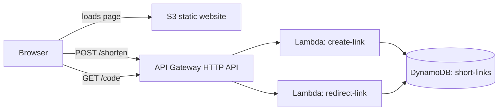

# Snip: a serverless URL shortener on AWS

A small "mini Bitly" built with AWS serverless services. Paste a long web address into the page, get back a short link, and anyone who opens the short link is redirected to the original address. Each visit is counted.

## Architecture



| Service | Role |
| --- | --- |
| **S3** | Hosts the static front end (`index.html`) |
| **API Gateway (HTTP API)** | Public endpoints: `POST /shorten` and `GET /{code}` |
| **Lambda (Python 3.12)** | `create-link` makes and stores a code; `redirect-link` looks it up and redirects |
| **DynamoDB** | Stores each link: `code`, `url`, `createdAt`, `clicks` |
| **IAM** | Least-privilege inline policies, one per Lambda |

## How it works

1. The page sends `POST /shorten` with `{"url": "https://..."}`.
2. `create-link` validates the address, generates a random 6-character code, and writes it to DynamoDB with a condition so two links can never share a code (it retries on a collision).
3. The API returns `{"code": "...", "shortUrl": "https://<api>/<code>"}`.
4. When someone opens the short link, `GET /{code}` runs `redirect-link`, which reads the item, adds 1 to `clicks`, and answers with a `302` redirect. Unknown codes get a friendly 404 page.

## API

**POST /shorten**

```json
// request
{ "url": "https://example.com/some/long/path" }

// response (201)
{ "code": "aB3xY9", "shortUrl": "https://<api-id>.execute-api.us-east-1.amazonaws.com/aB3xY9" }
```

Invalid addresses return `400` with `{ "error": "..." }`.

**GET /{code}** returns `302` with a `Location` header, or a `404` HTML page if the code does not exist.

## Project structure

```
frontend/index.html                 Static page (HTML, CSS, JS in one file)
backend/create_link/lambda_function.py
backend/redirect/lambda_function.py
iam/                                Inline IAM policies and the S3 bucket policy (placeholders)
tests/                              Sample Lambda test events
```

## Deploy it yourself (all in one region, e.g. us-east-1)

1. **DynamoDB:** create a table named `short-links` with partition key `code` (String) and On-demand capacity.
2. **Lambda:** create `create-link` and `redirect-link` (Python 3.12). Paste in the matching `lambda_function.py` and click Deploy. On both, add the environment variable `TABLE_NAME` = `short-links`.
3. **IAM:** on each function's execution role, add the matching inline policy from `iam/` (replace `YOUR_ACCOUNT_ID`).
4. **Test each function** in the Lambda console with the events in `tests/`. `create-link` should return `201`. Use the code it returns in `redirect-link-event.json`, which should return `302`.
5. **API Gateway:** create an HTTP API with two Lambda integrations and the routes `POST /shorten` and `GET /{code}`. Keep the `$default` stage with auto-deploy on. Under CORS, allow origin `*`, methods `GET, POST, OPTIONS`, and header `content-type`.
6. **Front end:** in `frontend/index.html`, set `API_URL` to your API's Invoke URL (no trailing slash).
7. **S3:** create a bucket, turn off Block Public Access, enable Static website hosting with `index.html` as the index document, add `iam/s3-bucket-policy.json` as the bucket policy (replace `YOUR_BUCKET_NAME`), and upload `index.html`.
8. Open the bucket's website endpoint and shorten a link.

## Troubleshooting

- **"Couldn't reach the server" on the page:** check the `API_URL` value and that CORS is saved on the API.
- **`AccessDeniedException` in a Lambda test:** the inline policy is missing or its table ARN has a typo.
- **`KeyError: 'TABLE_NAME'`:** the environment variable is missing on that function.
- **404 on a short link:** codes are case-sensitive; copy the exact code from the table.

## Ideas for next steps

- Custom domain on the API so short links are shorter
- CloudFront in front of S3 for HTTPS
- Restrict CORS to the website's own origin
- Link expiry using DynamoDB TTL
- Infrastructure as code with AWS SAM or Terraform

## Security notes

- The S3 bucket is public by design because it only serves the static page.
- The Lambdas can only touch the one table, and only with the actions they need.
- Never commit AWS keys, `.pem` files, or `.env` files. The `.gitignore` already excludes them.
